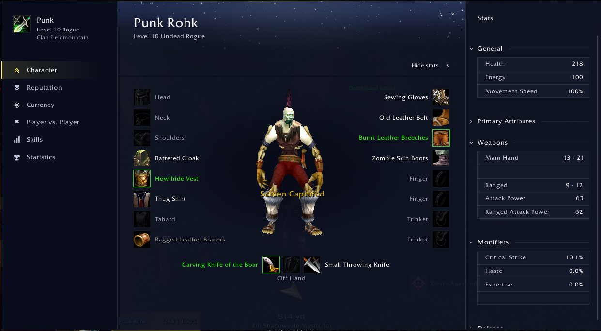
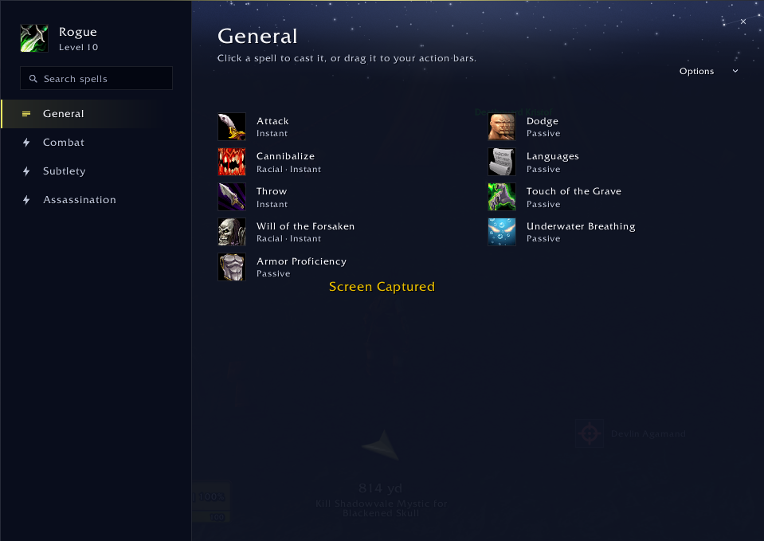
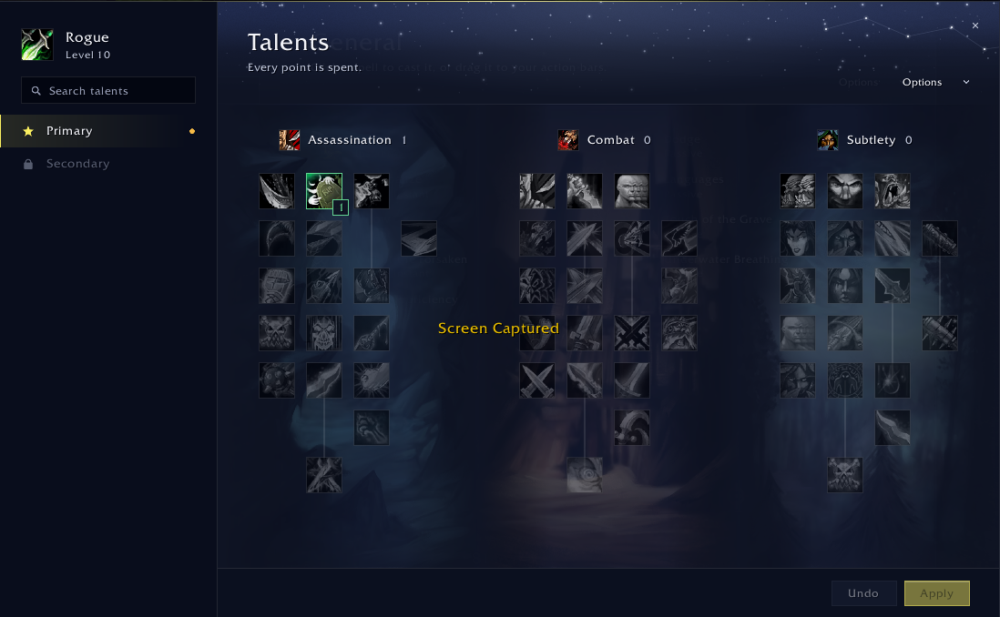

# Polestar: UI

A companion to [Polestar](https://github.com/fitzforge/polestar): the game's own windows remade in Polestar's look, drawn with Polestar's own widgets so they follow its scheme, accent and font live.

Still early: more windows are on the way. Done so far:

- **Character**: gear around the model, a foldable stats drawer, and Reputation, Currency, Player vs. Player, Skills and Statistics pages.
- **Spellbook**: every tab, search, cooldowns and pet autocast; click to cast or drag to your bars.
- **Talents**: the three trees on the class's art, search, and points staged until you Apply.
- **Professions**: a card per profession with its rank, spells and the game's card art.
- **Crafting**: recipes by category with "Can make now" and "Recent", search and the game's filters, reagents, and Craft or Craft all; switch professions from the rail.
- **Legacy**: the reward track, the challenges by category with search, filters and objectives, and the legacy tree with points staged until you Apply.
- **World Map and Quest Log**: the game's own map canvas with zones in the sidebar, zoom steps and full screen, and the quest log beside it.
- **Tooltips**: the game's own tooltips in Polestar's look, with every line other addons add to them.
- **Chat**: the game's own chat windows, tabs and input line in Polestar's look, at your chat opacity, with every line other addons add.







## Requirements

- [Polestar](https://github.com/fitzforge/polestar/releases).

## Install

Download `Polestar_UI-<version>.zip` from [Releases](https://github.com/rohkin/polestar-ui/releases) (not "Source code"), unzip it into `World of Warcraft/_forever_/Interface/AddOns/`, and restart the game.

## Use

- `/pui` lists the windows, each on (Polestar's) or off (the game's); `/pui character` opens the Character window.
- `/pui <window> off`, or "Use game window" in the window's "..." menu, gives the game's own window back at once (crafting after `/reload`); `/pui <window> on`, or the Polestar button above the game's window, brings ours back. Not in combat.
- The windows dock from the top left as the game's own do; `/pui dock off` lets you drag them anywhere.
- `/pui tooltips off` gives the game's tooltips their own look back at once; `/pui tooltips on` restyles them again.
- `/pui chat off` gives the chat windows their own look back at once; `/pui chat on` restyles them again.
- With Forever's gamepad UI on, every module starts off and `/pui` is not registered.

## Development

The design system is [docs/DESIGN.md](docs/DESIGN.md), on top of Polestar's own. Before building a surface, read [docs/CLIENT.md](docs/CLIENT.md): the client rules learnt from bugs in game, and how to read errors from it.

To load this working copy in the game: `npm run link` (a junction into `_forever_/Interface/AddOns`, found on its own or from `$WOW_FOREVER_ADDONS`; no admin), `npm run unlink` to remove it.

Needs Node 24+, a Lua 5.1 (`luajit` works; or set `LUA`), and a Polestar checkout at `../polestar` (or `$POLESTAR_DIR`).

```sh
npm test            # every scene must render as its golden in tests/golden, with no text overflowing
npm run preview     # re-render (re-bless) the goldens after a meant change
```

The renderer runs the real addon Lua on a stub of the client and draws every frame as SVG (`tools/preview.js`, scenes in `SCENES`). A failing scene writes `tests/golden/<scene>.actual.svg` next to its golden to compare.

The renderer and client stubs in `tools/preview`, `tools/lib`, `tests/lua` and `tests/helpers` come from Polestar, under the GPL-3.0.

## License

GPL-3.0-or-later. See [LICENSE](LICENSE).
